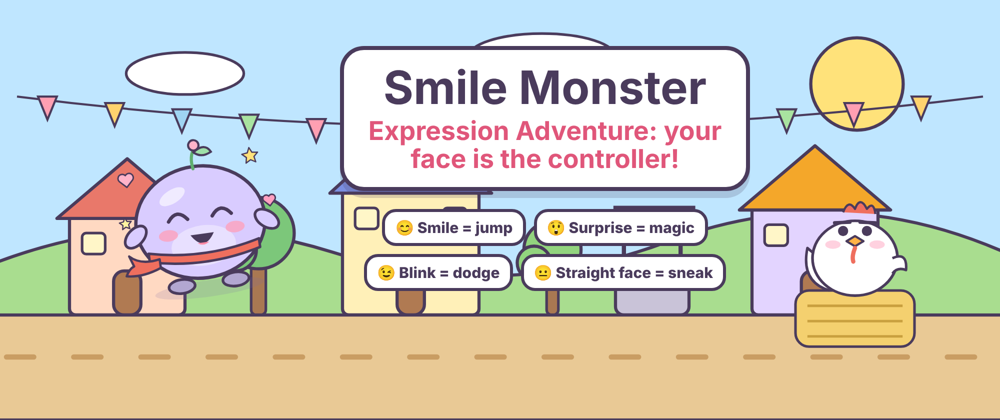
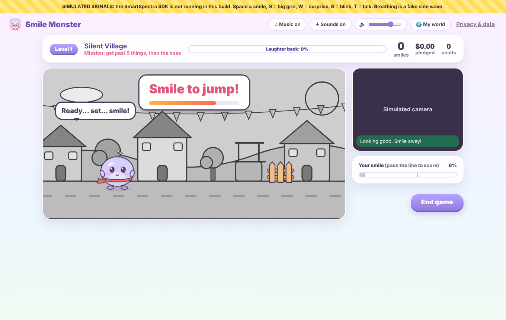
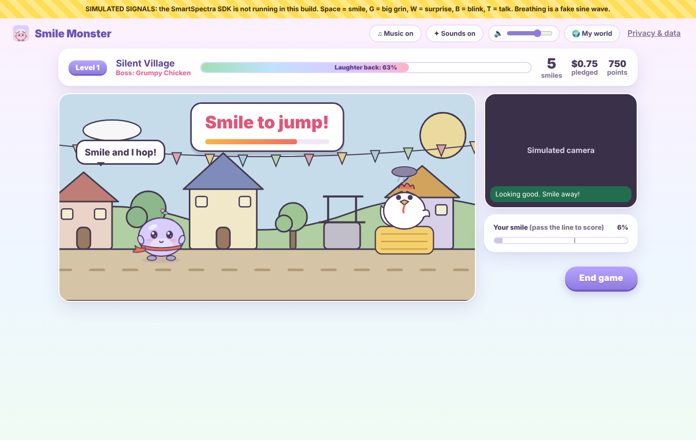
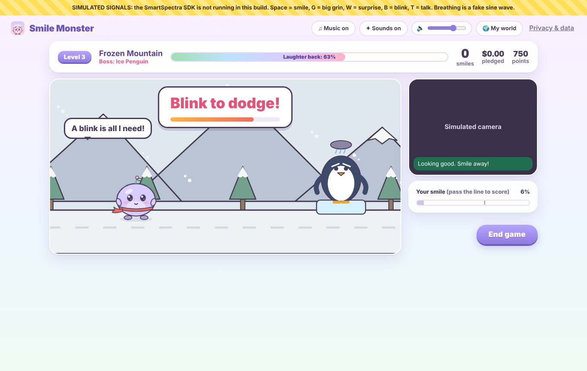
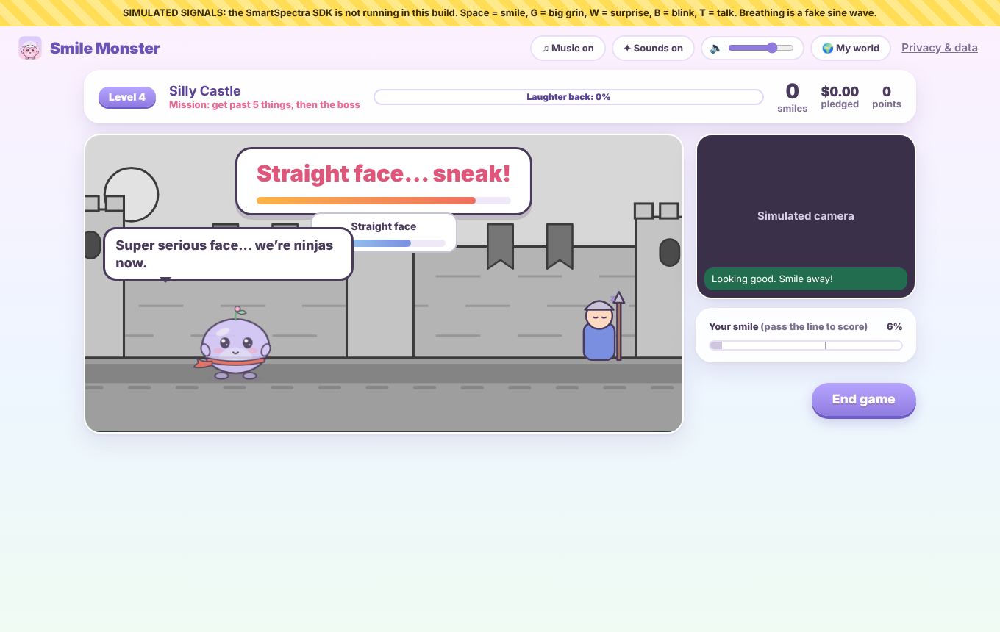

# Smile Monster: Expression Adventure 😊✨

**Your face is the controller!**



*The Grumpy Shadow stole every laugh in the Laughing Kingdom. Help Momo, a small round monster in a red scarf, win them back using nothing but your face.*

**Smile Monster: Expression Adventure** is a cute, funny desktop game where your real facial expressions, read live from the camera by the [Presage SmartSpectra SDK](https://github.com/Presage-Security/SmartSpectra), control the hero. Smile and Momo jumps. Look surprised and Momo casts magic. Blink and Momo ducks. Keep a straight face and Momo sneaks. Five levels, five bosses that get cheered up (nobody gets hurt), and every real smile also adds to a sponsor pledge for a charity you pick.

Built for the DEV Presage SmartSpectra SDK Challenge (`#presagechallenge`).

> Smile Monster is a game. It does not diagnose, treat or assess anyone's health or emotional state. It tracks pledges; it never processes payments.

| | |
| --- | --- |
|  |  |
|  |  |

*Screenshots in `docs/screenshots` were taken with `npm run simulate` (note the yellow banner), because the build machine has no camera.*

## How you play

| Your face | SDK signal | Momo |
| --- | --- | --- |
| Smile | `EXPRESSIONS`, HAPPY score | jumps (and bounces on bosses) |
| Look surprised | `EXPRESSIONS`, SURPRISE score | casts magic: zaps vine walls, opens doors, pops bubbles |
| Blink | `BLINKING`, `detected` flag | ducks under snowballs, icicles and falling pots |
| Straight face | `EXPRESSIONS`, NEUTRAL score (or HAPPY and SURPRISE both low) | tiptoes past sleeping guards |

A big sign at the top of the screen always says which face to make, with a bar showing how long you have. Each level runs the same loop: Momo explains the mission, a challenge appears, you make the face, Momo acts, you get points, and the next challenge comes. At the end there's a boss, then the next level opens.

**It's forgiving.** Each challenge gives about three seconds. Miss it and Momo tumbles over, says something silly ("Oops. I meant to land on my face. Totally on purpose.") and you try again with a bit more time. There is no game over. A face you made a moment before the challenge opened still counts. Stars depend on tumbles: none is 3 stars, up to three is 2, and finishing always gets at least 1.

**The five levels**

| Level | Faces | Boss |
| --- | --- | --- |
| 1. Silent Village | smile | **Grumpy Chicken**: bounce on its hay bale three times until it laughs |
| 2. Crazy Forest | smile, surprise | **Dancing Tree**: copy its smile, surprise, smile, surprise dance |
| 3. Frozen Mountain | smile, blink | **Ice Penguin**: dodge its snowballs, then melt its frown with a smile |
| 4. Silly Castle | straight face, blink, surprise | **Giant Grumpy Ghost**: pop its grumpy bubbles with magic |
| 5. Final Laugh | all four | **Grumpy Shadow**: every face gives back a stolen laugh, until the Shadow laughs too |

Each level starts grey and gets its colour back as you clear challenges. The home screen's world brightens as you finish levels, and a level map shows your best stars. You can replay any open level.

**Momo** is cheeky, a bit clumsy and always on your side. It has poses for running, getting ready, jumping, tumbling, ducking, casting magic, tiptoeing and a victory dance, and its face copies yours through a smoothing filter so it doesn't flicker.

**Voice and music.** Momo reads its lines aloud using the speech voices installed on your computer (only on-device voices, so no text goes online). It says one line at a time, never talks over itself, and the music dips while it speaks. Every line also shows in a speech bubble, so nothing is lost on a computer without voices. Music is generated live in the app: a dreamy story theme, a calm home theme, a bouncy level track, a sneaky boss groove and a victory fanfare. **Music**, **Sounds** and **Voice** each have their own switch, plus a volume slider.

**Opening story.** Four short scenes: the Laughing Kingdom, the Grumpy Shadow stealing the laughs, a mysterious egg, and Momo hatching. It plays once and can be replayed from My world.

## How the face controls work

All four controls come from real SDK data: Expression samples `{ stable, timestamp (µs), scores: [{ type, confidence 0-100 }] }` and blink statuses `{ detected, stable, timestamp }`. Nothing is invented. There's no "big smile" signal in the SDK, so the game doesn't use one.

`src/adventure/controls.js` smooths each score over about 120 ms using the SDK timestamps, then:

| Action | Fires when | Re-arms when | Cooldown |
| --- | --- | --- | --- |
| Jump | smoothed HAPPY rises past 55 | HAPPY stays below 35 for 0.3 s | 0.6 s |
| Magic | smoothed SURPRISE rises past 50 | SURPRISE stays below 25 for 0.3 s | 1 s |
| Dodge | a new blink starts (`detected` false → true) | the blink ends | 0.5 s |
| Sneak | a straight face is held for 0.9 s inside the challenge window | any other expression | none |

So holding one expression never repeats an action, and nothing needs a long or uncomfortable hold. Blinks only matter while something is flying at Momo, so normal blinking doesn't do anything odd. If the face leaves the camera, every control relaxes by itself.

**Backup when a signal is missing.** If blink data isn't arriving (some cameras, glasses or lighting), dodging switches to a surprised face and a note on screen says so. The optional signal check panel (My world → Settings → "Show the signal check during games") shows which signals are actually live.

These thresholds are starting points chosen in simulate mode. They haven't been tuned on a real camera yet.

## Real-world impact

Every **qualifying smile** also counts for charity. That's still decided by the original `SmileDetector` (HAPPY ≥ 60% held for 0.5 s, then relaxed before the next one), completely separate from the game controls, so a jump can never be counted twice and gameplay can't change a pledge. Each sponsor pledges an amount per smile (the default example is 10¢), up to a cap they set. Amounts are kept in whole US cents.

**Pledged** (promised, worked out from smiles and caps) and **Confirmed donated** (what you record after a sponsor actually gives) are always shown separately. The player never pays anything; sponsors donate to the charity themselves. After the Final Laugh, Momo explains this in its own words.

**Sponsor snacks.** A sponsor can add a joke. Momo tells one at the start of a level ("Snack time! Grandma Lee sent you a joke..."), and if it makes you really smile, that sponsor gets the credit.

**Smile Receipt.** After a level, save a PNG with Momo, the level and stars, the qualifying smiles, each sponsor's pledge, the campaign's pledged and confirmed totals, and the charity. It never contains a camera image. A CSV pledge statement can be exported from My world.

## How it works

```
camera ──► SmartSpectra SDK (renderer captures frames, main process analyses them on-device)
                │  'metrics' event (protobuf) → decodeMetrics(buf)
                ▼
   face.expression[] ──► ExpressionControls ──► jump / magic / sneak ─┐
                    └──► SmileDetector ──► qualifying smile ──► pledges.js (caps, USD cents)
   face.blinking[]  ──► ExpressionControls ──► dodge ─────────────────┤
                                                                       ▼
                                            AdventureLevel (intro → challenges → boss → outro)
                                                                       │
                                     scenes.js + Momo SVG + MomoVoice + music ◄┘
   all signals ──► SignalMonitor ──► signal check chips, and the blink → surprise backup
```

The SDK integration is in [`renderer.js`](renderer.js) (`buildSdk`, `wireSdk`, `handleMetrics`) and [`main.js`](main.js) (`bindSmartSpectraIpc`). The app requests `faceMetrics` (landmarks, blinking, talking, expressions), adds `breathingMetrics` when "Momo breathes with you" is on, and `cardioMetrics` when pulse is on.

## Setup

**You need:** Node.js 22.12 or newer (24 LTS recommended; older 22.x fails to install Electron with `ERR_REQUIRE_ESM`), a webcam, and a free SmartSpectra API key from <https://physiology.presagetech.com/>.

```bash
git clone https://github.com/tony123S/smile-jar.git
cd smile-jar
npm install                 # pulls @smartspectra/node-sdk and its native runtime (a few hundred MB)
cp .env.example .env        # then paste your key: SMARTSPECTRA_API_KEY=...
npm start                   # bundles the renderer and launches Electron
```

On Windows PowerShell you can copy the file with `Copy-Item .env.example .env`. If the app closes straight away from a VS Code terminal, run `$env:ELECTRON_RUN_AS_NODE=$null; npm start` (PowerShell) or `env -u ELECTRON_RUN_AS_NODE npm start` (macOS/Linux).

The key is read at build time from `.env` (or the `SMARTSPECTRA_API_KEY` environment variable) and baked into `dist/`, which is git-ignored. Don't commit `.env` or `dist/`.

### Testing guide for judges

1. `npm start`. The opening story plays first. Click **Continue** through the four scenes (or **Skip story**). Music starts after your first click.
2. The camera consent screen comes next. Tick the agreement and press **Meet Momo**. (The diagnostics box is optional and off by default.) The camera has not been touched yet.
3. The home screen shows Momo, the level map and the Real-world impact card. Optional: turn on **My world → Settings → Show the signal check during games** to see which SDK signals really arrive.
4. Press **PLAY**. A short **How to play** guide appears the first time, then the SDK opens the camera (the OS may ask for permission).
5. Level 1, Silent Village: smile when the sign says "Smile to jump!". Hold still and let a window run out once to see Momo tumble and retry. A real smile while the sponsor's joke is up credits that sponsor.
6. Beat the Grumpy Chicken. The results screen shows stars, points, qualifying smiles and each sponsor's pledge. Press **Save Smile Receipt**.
7. Back home, Level 2 is open. In Crazy Forest, look surprised to zap the vines. In Frozen Mountain, blink to duck. In Silly Castle, keep a straight face to sneak.
8. Open **My world**, type an amount in **Donated ($)** for a sponsor: Pledged and Confirmed donated update separately. Try **Export pledge statement (CSV)**.
9. Open **Privacy & data** and press **Delete all my data** to see the wipe.

To try every level without playing through, use `npm run simulate`: Space = smile, W = surprise, B = blink, no key = straight face.

### Other commands

| Command | What it does |
| --- | --- |
| `npm test` | Unit tests: face controls (edges, re-arming, cooldowns, blink backup), level flow, retries, stars and unlocks, all five levels, Momo's voice queue, music loops, smile detector, pledges and confirmed donations, saves from earlier versions |
| `npm run simulate` | Launches the UI with a **fake** signal for UI work (Space = smile, W = surprise, B = blink, no key = straight face, T = talk, breathing is a sine wave). A yellow banner says so on every screen. The real build never uses it |
| `npm run dist:mac` / `dist:win` / `dist:linux` | Packaged installers via electron-builder |

### Troubleshooting

| Symptom | Fix |
| --- | --- |
| "No SmartSpectra API key in this build" | Create `.env` from `.env.example` and run `npm start` again |
| SmartSpectra error 2 (authentication) | Key is wrong or revoked. Check it at physiology.presagetech.com |
| SmartSpectra error 4 (credits) | Your Presage plan is out of credits |
| A signal chip stays on "waiting" | That signal isn't arriving with your key or setup. Breathing needs the chest visible; pulse needs a cardio-enabled key |
| Hint says "can't see a face" / "too dark" | These come straight from the SDK's validation status. Face the camera with light in front of you |
| Smiles not counting | The bar must pass the marker (60%) for half a second, then drop back down before the next smile |

## Consent and Data Handling

**Camera consent.** After the opening story (which never uses the camera), the app shows a consent screen that explains the points below and requires the user to tick an agreement before anything else is available. The camera is never opened during the story, on the consent screen or on the home screen. It is opened by the SDK only when the user presses PLAY (after the How to play guide the first time), and released when the game ends, the user deletes their data, or the window closes. A "Live, not recorded" badge is shown while it's on, alongside the OS camera indicator. The Electron main process grants only video (never the microphone) and only to the app's own bundled page. Talking detection comes from the video, not from audio. The consent text asks users to count only their own smiles or those of people who knowingly agreed to take part; the app must not be used for covert monitoring.

**What is processed.** Camera frames go from the renderer to the SmartSpectra SDK running inside the app's main process, are analysed on the device, and are discarded. Smile Monster reads expression scores, blink and talking flags, the breathing trace (if "Momo breathes with you" is on) and pulse (if turned on). It uses them in memory to control and animate Momo, update the meter and count smiles, then drops them.

**What is stored.** One record in the app's local storage on this device (`smilemonster.v1`; a save from an earlier version of the app is moved to this name the first time it opens, and the old copy is removed only after the move worked): whether the opening story has been seen; the consent version and time; settings (breathing mirror, pulse, music, sound effects, voice, volume, diagnostics); the cause and goal; sponsor names, rates, caps, colours, snack jokes, snack-smile counts and the confirmed donation amounts the user typed; adventure progress (levels unlocked, best stars and points per level); a smile total and snack smiles per sponsor (plus counts kept from the earlier version of the app); and per-game totals (end time, duration, number of smiles, pledged amount).

**What is never stored or sent by Smile Monster.** Video, images, screenshots, face landmarks, expression scores, blink, talking or breathing data, pulse values, or any other biometric data. The blink count on the results screen is a number for that screen only. The face controls and the mood filter are discarded when the game ends.

**Smile Receipt and CSV.** Both are generated on the device only when the user clicks to save or export. The receipt has the Momo drawing, totals, sponsor names and amounts, and the charity, never a camera image. The CSV has the cause, sponsor names, rates, caps, pledged and confirmed amounts, snack smile counts, and session dates and smile counts. They leave the device only if the user sends them to someone.

**Sharing.** None. Smile Monster has no backend, no account, no analytics and no ads. The music, sounds and artwork are generated inside the app, so nothing is downloaded for them.

**Retention and deletion.** Local data is kept until the user deletes it. **Privacy & data → Delete all my data** erases the whole record, including consent, and starts over from the story. **Don't save this game** on the results screen removes that game, including its stars and unlocks. **Start the adventure again** resets level progress but keeps pledges. Uninstalling the app (and clearing its app-data folder) also removes everything.

**SDK network use and telemetry.** The SmartSpectra SDK connects to Presage over TLS to validate the API key and meter usage. It can also send an aggregate, per-session diagnostic summary (SDK version, OS/device model, frame-rate and quality counters, error codes) that by Presage's documentation contains no video, no measured values and no user or device identifiers ([SDK Telemetry & Privacy](https://github.com/Presage-Security/SmartSpectra/blob/main/docs/telemetry-and-privacy.md)). The SDK turns this on by default; **Smile Monster turns it off** (`enableTelemetry: false`) unless the user opts in on the consent screen or in Privacy & data. See [Presage's Privacy Policy](https://api.physiology.presagetech.com/privacypolicy).

**Momo's voice.** Spoken by the speech voices installed on the computer, and only voices marked as on-device are used, so Momo's lines are never sent to an online speech service. It can be switched off.

**AI services.** None. The SDK's optional LLM Insights feature is not used.

**Payments.** None. The player never pays anything. Smile Monster records pledges and the donations the user marks as confirmed. Sponsors donate to the charity directly.

## Project structure

```
main.js                     Electron main: window, SmartSpectra IPC bridge, camera-only permission
renderer.js                 Screens (story, consent, home, level, results, my world), SmartSpectra wiring
src/adventure/controls.js   Real SDK scores and blink flags → jump, magic, dodge, sneak (edges, re-arm, cooldowns)
src/adventure/engine.js     Plays one level: intro, challenges, retries, boss, outro, stars
src/adventure/levels.js     The five levels and bosses as data; saved progress
src/adventure/scenes.js     Level backgrounds, obstacles and bosses (SVG)
src/adventure/voice.js      Momo's spoken lines: one at a time, music dips, on-device voices only
src/adventure/lines.js      Momo's oops and ready lines
src/monster.js              The Momo drawing (and the egg used in the story)
src/mood.js                 Smooths live expression scores into a calm face for Momo
src/smile-detector.js       Expression stream → qualifying smiles for charity (hysteresis)
src/pledges.js              Sponsor caps, pledges in USD cents, confirmed donations, CSV statement
src/store.js                The single local record, migration of older saves, wipe
src/signals.js              Signal monitor, blink edges, talking flag, breathing normaliser
src/music.js, audio.js      Original looping music and the music / sound-effect buses
src/sounds.js               Sound effects (no files)
src/receipt.js              Draws the Smile Receipt PNG
src/simulator.js            UI-only fake signal for `npm run simulate`
test/                       node:test unit tests
```

Some modules from the earlier joke-card version (`joy-reel.js`, `humour.js`, `behaviour.js`, `monster-voice.js`) are still in the repo; the home screen still uses `behaviour.js` to let Momo wander.

## License

MIT for the Smile Monster code. The SmartSpectra SDK is licensed separately by Presage Technologies; see its package's LICENSE.
