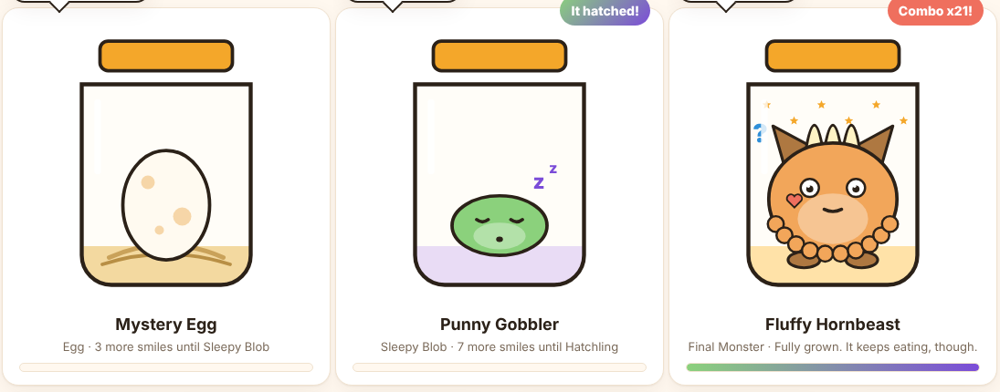

# Smile Jar: The Smile Monster 🫙👾

**A monster lives in a jar on your desktop, and it eats smiles.** Friends, family or coworkers pledge an amount per smile (say 10¢, capped at $10) to a charity you pick. You sit down for a two-minute session of jokes and happy facts. The [Presage SmartSpectra SDK](https://github.com/Presage-Security/SmartSpectra) watches the camera live, and every real smile feeds the monster, drops a coin and adds to the pledge. The monster grows from an egg into a one-of-a-kind creature shaped by *what* made you laugh.

Built for the DEV Presage SmartSpectra SDK Challenge (`#presagechallenge`).

> Smile Jar is a game. It does not diagnose, treat or assess anyone's health or emotional state. It tracks pledges; it never processes payments.



*Screenshots in `docs/screenshots` were taken with `npm run simulate` (note the yellow banner), because the build machine has no camera.*

## What it does

**A monster that mirrors your real signals.** While a session runs, the monster copies you using SmartSpectra signals as they arrive:

| You | SDK signal | The monster |
| --- | --- | --- |
| Smile | `EXPRESSIONS` (HAPPY score) | grins, blushes, and eats the smile when it counts |
| Look surprised | `EXPRESSIONS` (SURPRISE score) | its eyes and mouth go wide |
| Blink | `BLINKING` (`detected` flag) | blinks with you |
| Talk | `TALKING` (`detected` flag) | puts on a "?" listening face |
| Breathe | breathing bundle (chest trace, optional) | its belly rises and falls with yours |

A **Live signals** panel under the meter shows which of these signals are actually arriving right now (`live`), stopped (`paused`), never seen (`waiting`) or not requested (`off`). If a signal never arrives, the monster simply doesn't use it. Nothing is faked in the real build.

**Four evolution stages.** Egg (0 smiles) → Sleepy Blob (3) → Hatchling (10) → Final Monster (20). The egg wobbles and cracks as it fills, the blob snoozes until you make it smile, and each evolution plays an animation, a sound and a line from the monster.

**Humour shapes how it looks.** Every counted smile is credited to the card that was on screen when the smile started, and that card's category becomes part of the monster's "diet":

- Puns grow **horns**
- Animal facts grow **fur and ears**
- Memories make it **glow**
- Picture-this daydreams grow **stars**
- Sponsor snacks add **hearts in the sponsor's colour**
- Surprise moments make its **eyes bigger**; long straight faces in Try Not to Smile add **stone patches**

The top two categories set its colour and its name (for example "Fluffy Hornbeast" or "Glowing Stargazer"), so two people's monsters end up different. The joke reel also learns, within the session, which category works on you and serves more of it.

**Sponsor Snacks.** Each sponsor can add a joke or memory of their own. The monster serves it as "A snack from Grandma Lee". If it makes you smile, that sponsor gets the credit: a badge, a heart on the monster, and a "snack smiles" count on the home screen, in the CSV and on the receipt.

**Pledges with caps, kept separate from donations.** Each sponsor has a rate per qualifying smile and an optional cap. The home screen shows **Pledged** (promised, worked out from smiles and caps) and **Confirmed donated** (what you record after a sponsor actually donates) side by side, with the amount still to go per sponsor. Smile Jar never takes or moves money.

**Smile Receipt.** At the end of a session, save a PNG with the monster, its name and stage, the qualifying smiles, each sponsor's pledge for the session, the campaign's pledged and confirmed totals, and the charity. It says plainly that pledged means promised, not paid. It contains no camera image.

**Two ways to play.** *Feed the monster:* smile at the cards. *Try Not to Smile:* keep a straight face while the monster teases you as your HAPPY score creeps up. Every crack still counts and your sponsors still pay.

Also: combos, golden grins (HAPPY ≥ 92%), synthesized sound effects (mutable), "play my own clip", an optional live pulse readout, and a CSV pledge statement.

## How it works

```
camera ──► SmartSpectra SDK (renderer captures frames, main process analyses them on-device)
                │  'metrics' event (protobuf) → decodeMetrics(buf)
                ▼
   face.expression[] ──► SmileDetector ──► +1 qualifying smile ──► pledges.js (caps)
          │                                    │
          │                                    └─► HumourModel.creditSmile() ──► monster diet ──► traits
          ├─► mascotFace()      (grin / wow)  ─┐
   face.blinking[]  ──► BlinkTracker          ├─► monsterSvg() redrawn once per frame
   face.talking[]   ──► talkingNow()          │
   breathing trace  ──► BreathNormalizer     ─┘
   all of the above ──► SignalMonitor ──► "Live signals" chips
```

`SmileDetector` uses hysteresis: HAPPY ≥ 60% held for 0.5 s counts one smile, then HAPPY must drop below 35% for 0.7 s before the next can count. One long grin counts once and a flicker doesn't count. We don't claim to tell real from fake smiles beyond that.

The SDK integration is in [`renderer.js`](renderer.js) (`buildSdk`, `wireSdk`, `handleMetrics`) and [`main.js`](main.js) (`bindSmartSpectraIpc`). The app requests `faceMetrics` (landmarks, blinking, talking, expressions), adds `breathingMetrics` when "Monster breathes with you" is on, and `cardioMetrics` when pulse is on.

## Setup

**You need:** Node.js 22.12 or newer (24 LTS recommended; older 22.x fails to install Electron with `ERR_REQUIRE_ESM`), a webcam, and a free SmartSpectra API key from <https://physiology.presagetech.com/>.

```bash
git clone https://github.com/tony123S/smile-jar.git
cd smile-jar
npm install                 # pulls @smartspectra/node-sdk and its native runtime (a few hundred MB)
cp .env.example .env        # then paste your key: SMARTSPECTRA_API_KEY=...
npm start                   # bundles the renderer and launches Electron
```

On Windows PowerShell you can copy the file with `Copy-Item .env.example .env`. If the app closes straight away from a VS Code terminal, run `$env:ELECTRON_RUN_AS_NODE=$null; npm start` (PowerShell) or `env -u ELECTRON_RUN_AS_NODE npm start` (macOS/Linux).

The key is read at build time from `.env` (or the `SMARTSPECTRA_API_KEY` environment variable) and baked into `dist/`, which is git-ignored. Don't commit `.env` or `dist/`.

### Testing guide for judges

1. `npm start`. The consent screen comes first. Tick the agreement and press **Wake the monster**. (The diagnostics box is optional and off by default.)
2. The home screen shows the egg, two example sponsors with snack jokes, and the charity. Edit anything you like.
3. Press **Feed the monster**. The OS may ask for camera permission. The hint on the preview tells you when the SDK is running and how to sit.
4. Look at the **Live signals** chips. They show which SmartSpectra signals your key and setup are really delivering.
5. Smile at the cards. Watch the HAPPY bar cross the marker, a coin drop, and the egg crack. Three smiles hatch it. Blink, talk, look surprised and breathe, and watch the monster copy you.
6. Smile at a "Sponsor snack" card to see the sponsor get credit.
7. Press **End session**. The camera turns off and the summary shows the monster, sponsor pledges and charity. Press **Save Smile Receipt**.
8. Back home, type an amount in **Donated ($)** for a sponsor to see Pledged vs Confirmed donated update. Try **Export pledge statement (CSV)** and **Try Not to Smile**.
9. Open **Privacy & data** and press **Delete all my data** to see the wipe.

Breathing needs your chest in view (sit back a little). Pulse needs an API key provisioned for cardio metrics; leave it off if yours isn't.

### Other commands

| Command | What it does |
| --- | --- |
| `npm test` | Unit tests: smile detector, pledges and confirmed donations, monster stages and traits, signal tracking, humour model, store migration |
| `npm run simulate` | Launches the UI with a **fake** signal for UI work (Space = smile, G = big grin, W = surprise, B = blink, T = talk, breathing is a sine wave). A yellow banner says so on every screen. The real build never uses it |
| `npm run dist:mac` / `dist:win` / `dist:linux` | Packaged installers via electron-builder |

### Troubleshooting

| Symptom | Fix |
| --- | --- |
| "No SmartSpectra API key in this build" | Create `.env` from `.env.example` and run `npm start` again |
| SmartSpectra error 2 (authentication) | Key is wrong or revoked. Check it at physiology.presagetech.com |
| SmartSpectra error 4 (credits) | Your Presage plan is out of credits |
| A signal chip stays on "waiting" | That signal isn't arriving with your key or setup. Breathing needs the chest visible; pulse needs a cardio-enabled key |
| Hint says "can't see a face" / "too dark" | These come straight from the SDK's validation status. Face the camera with light in front of you |
| Smiles not counting | The bar must pass the marker (60%) for half a second, then drop back down before the next smile |

## Consent and Data Handling

**Camera consent.** The app opens on a consent screen that explains the points below and requires the user to tick an agreement before anything else is available. The camera is never opened on that screen or on the home screen. It is opened by the SDK only when the user starts a session, and released when the session ends, the timer runs out, the user deletes their data, or the window closes. A "Live, not recorded" badge is shown while it's on, alongside the OS camera indicator. The Electron main process grants only video (never the microphone) and only to the app's own bundled page. Talking detection comes from the video, not from audio. The consent text asks users to count only their own smiles or those of people who knowingly agreed to take part; the app must not be used for covert monitoring.

**What is processed.** Camera frames go from the renderer to the SmartSpectra SDK running inside the app's main process, are analysed on the device, and are discarded. Smile Jar reads expression scores, blink and talking flags, the breathing trace (if "Monster breathes with you" is on) and pulse (if turned on). It uses them in memory to draw the monster, update the meter and count smiles, then drops them.

**What is stored.** One record in the app's local storage on this device (`smilejar.v1`): the consent version and time; settings (session length, breathing mirror, pulse, sound, diagnostics); the cause and goal; sponsor names, rates, caps, colours, snack jokes, snack-smile counts and the confirmed donation amounts the user typed; the monster (smiles eaten, smiles per joke category, surprise-moment count, stone-face session count, snack smiles per sponsor); names of retired monsters; and per-session totals (end time, duration, mode, number of smiles, pledged amount).

**What is never stored or sent by Smile Jar.** Video, images, screenshots, face landmarks, expression scores, blink, talking or breathing data, pulse values, or any other biometric data. The blink count on the summary is a number for that screen only. The in-session humour model is discarded when the session ends. A video clip the user plays is opened from their disk through a temporary local URL and never copied or uploaded.

**Smile Receipt and CSV.** Both are generated on the device only when the user clicks to save or export. The receipt has the monster drawing, totals, sponsor names and amounts, and the charity, never a camera image. The CSV has the cause, sponsor names, rates, caps, pledged and confirmed amounts, snack smile counts, and session dates and smile counts. They leave the device only if the user sends them to someone.

**Sharing.** None. Smile Jar has no backend, no account, no analytics and no ads.

**Retention and deletion.** Local data is kept until the user deletes it. **Privacy & data → Delete all my data** erases the whole record, including consent, and returns to the consent screen. **Don't save this session** on the summary removes that session and undoes what it fed the monster. **Start a new monster** resets the monster but keeps pledges. Uninstalling the app (and clearing its app-data folder) also removes everything.

**SDK network use and telemetry.** The SmartSpectra SDK connects to Presage over TLS to validate the API key and meter usage. It can also send an aggregate, per-session diagnostic summary (SDK version, OS/device model, frame-rate and quality counters, error codes) that by Presage's documentation contains no video, no measured values and no user or device identifiers ([SDK Telemetry & Privacy](https://github.com/Presage-Security/SmartSpectra/blob/main/docs/telemetry-and-privacy.md)). The SDK turns this on by default; **Smile Jar turns it off** (`enableTelemetry: false`) unless the user opts in on the consent screen or in Privacy & data. See [Presage's Privacy Policy](https://api.physiology.presagetech.com/privacypolicy).

**AI services.** None. The "learns your humour" feature is a small counting model in the app, not an AI service. The SDK's optional LLM Insights feature is not used.

**Payments.** None. Smile Jar records pledges and the donations the user marks as confirmed. Sponsors donate to the charity directly.

## Project structure

```
main.js                 Electron main: window, SmartSpectra IPC bridge, camera-only permission
renderer.js             UI, SmartSpectra renderer SDK wiring, live mirroring
src/monster.js          Stages, traits from the joke diet, names, the monster SVG
src/signals.js          Signal monitor, blink edges, talking flag, breathing normaliser
src/smile-detector.js   Expression stream → qualifying smiles (hysteresis)
src/pledges.js          Sponsor caps, session pledge, confirmed donations, CSV statement
src/store.js            The single local record, migration of older saves, wipe
src/joy-reel.js         Built-in cards, grouped by kind
src/humour.js           Learns which kind of card makes you smile (in memory only)
src/jar-voice.js        What the monster says, and when
src/sounds.js           Web Audio sound effects (no files)
src/receipt.js          Draws the Smile Receipt PNG
src/simulator.js        UI-only fake signal for `npm run simulate`
test/                   node:test unit tests
```

## License

MIT for the Smile Jar code. The SmartSpectra SDK is licensed separately by Presage Technologies; see its package's LICENSE.
