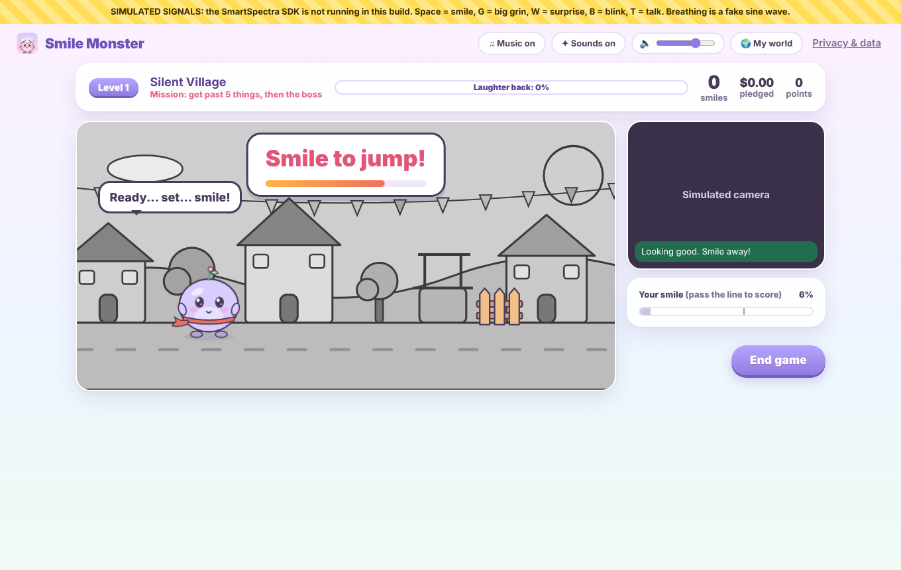
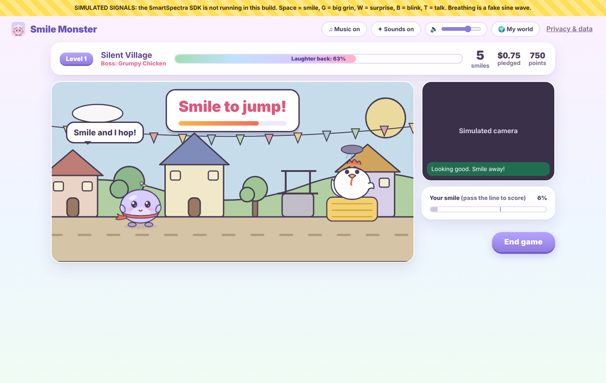
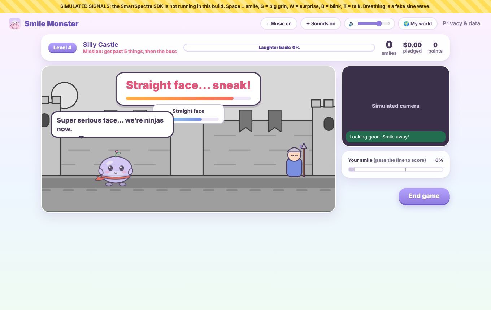

<!--
  BEFORE YOU PUBLISH (delete this comment):
  1. Merge the expression-adventure pull request first, so the screenshot links below work.
  2. Run the real app (npm start) with your camera and API key. Turn on
     My world > Settings > "Show the signal check during games" and play Levels 1 to 3.
     - If the Blinking chip stays on "waiting", say in "How It Responds to Human Signals"
       that blinks didn't arrive for you and dodging used the surprised-face backup.
     - If jumping or sneaking felt too easy or too hard, tell Claude and the thresholds get tuned.
  3. Upload docs/cover.png as the cover image.
  4. Replace VIDEO_URL with your demo video, and AGENT_SESSION_URL with your public transcript link.
-->

*This is a submission for the [Presage SmartSpectra SDK Challenge](https://dev.to/challenges/presage-2026-11-04)*

## What I Built

> The Grumpy Shadow stole every laugh in the Laughing Kingdom. Momo, a small round monster in a red scarf, wants them back. You don't get a keyboard. You get your face.

**Smile Monster: Expression Adventure** is a little desktop game where the SmartSpectra SDK reads your expressions through the camera and they *are* the controls:

- **Smile** and Momo jumps
- **Look surprised** and Momo does magic
- **Blink** and Momo ducks
- **Keep a straight face** and Momo sneaks

There are five levels, and each boss gets cheered up instead of beaten up:

1. **Silent Village**: smile over fences, puddles and a sleeping cat, then bounce on the **Grumpy Chicken's** hay bale until it laughs.
2. **Crazy Forest**: look surprised to zap vine walls, then copy the **Dancing Tree's** smile-surprise dance.
3. **Frozen Mountain**: blink to duck snowballs, then melt the **Ice Penguin's** frown with a smile.
4. **Silly Castle**: keep a straight face to tiptoe past sleeping guards (smile and they wake up with a "!"), then pop the **Giant Grumpy Ghost's** bubbles.
5. **Final Laugh**: all four faces, and the **Grumpy Shadow** turns out to just want someone to make it laugh.







*(These are from simulate mode, which is why there's a yellow banner.)*

Each level starts grey and gets its colour back as you clear things. Miss a challenge and Momo falls flat on its face, says something like "Oops. I meant to land on my face. Totally on purpose." and you just try again with a bit more time. There's no game over, because nobody should feel bad at a smiling game.

Momo talks (using your computer's own speech voices), the music changes for levels, bosses and the victory dance, and music, sound effects and voice each have their own switch.

And there's a real-world side. Walking can donate your steps, so why can't a smile raise money? Friends or family pledge a few cents per smile to a charity, with a cap so nobody gets a surprise bill. A sponsor can even add a joke, and Momo tells it at the start of a level. If it gets you, that sponsor gets the credit. After the Final Laugh, Momo explains where the pledges go.

## Demo



## Code



To run it: `npm install`, put your SmartSpectra API key in a `.env` file, then `npm start`. The README has the full steps and a short testing guide for judges. There's no login. `npm run simulate` runs it without a camera (Space = smile, W = surprise, B = blink, no key = straight face).

## How It Responds to Human Signals

I'm using the SmartSpectra Node.js/Electron SDK. I ask for the face bundle (expressions, blinking, talking), plus breathing if "Momo breathes with you" is on:

```js
const requestedMetrics = [...faceMetrics];
if (settings.breathMirror) requestedMetrics.push(...breathingMetrics);
if (settings.showPulse) requestedMetrics.push(...cardioMetrics);

const sdk = new SmartSpectraSDK({ apiKey, requestedMetrics, enableTelemetry: false });
sdk.on('metrics', (buf) => handleMetrics(decodeMetrics(buf)));
```

Every control comes from something the SDK really sends. Expression samples look like `{ stable, timestamp, scores: [{ type, confidence }] }`, and blinks are `{ detected, stable, timestamp }`:

| You | SDK signal | Momo |
| --- | --- | --- |
| Smile | HAPPY score | jumps |
| Look surprised | SURPRISE score | casts magic |
| Blink | `blinking[].detected` | ducks |
| Straight face | NEUTRAL score (or HAPPY and SURPRISE both low) | sneaks |
| Talk | `talking[].detected` | moves its mouth |
| Breathe | breathing trace | its body rises and falls with yours |

The fun part was making a face feel like a button without it being twitchy. Raw scores jump around, so each one is smoothed over about 120 ms using the SDK's own timestamps. Then every action fires once, on the moment the expression starts, and can't fire again until you relax for a moment. So holding a grin is one jump, not thirty. Jump, magic and dodge each have their own thresholds and cooldowns (magic has a longer cooldown, so one surprised face can't zap twice). Sneaking needs a straight face held for about a second, but it has to be *during* the guard's window, otherwise you'd sneak past just by sitting there. Nothing ever needs a long, uncomfortable hold.

Blinks were tricky because everybody blinks all the time. So a blink only does something while something is actually flying at Momo. And if blink data doesn't come through (glasses, lighting, some cameras), dodging switches to a surprised face and the game tells you. There's no "big smile" signal in the SDK, so I didn't invent one.

Money is kept out of all this on purpose. The charity smile count is a separate, stricter detector (HAPPY above 60% for half a second, then relax), the same one I had before the game changed. The game controls can't change a pledge, and a smile can't be counted twice.

I really didn't want to fake anything, so there's a **signal check** panel that shows which SDK signals are actually arriving. It's hidden for normal players and you turn it on in settings. There's also a simulate mode (`npm run simulate`) so I could build levels without burning API credits. It uses keys instead of the camera, and a big yellow "SIMULATED SIGNALS" banner stays on screen the whole time.

## Prize Categories

I'm entering both: **Most Creative or Delightful Use** and **Best Thoughtful Real-World Use**.

### Most Creative or Delightful Use

Most camera demos measure you. This one hands you a game controller made of your own face. You end up pulling silly faces at a laptop to make a round little monster jump over a cat, sneak past a snoring guard or tickle a grumpy chicken, and it's hard not to laugh, which, conveniently, is the point. Every boss is won over instead of beaten, so it works for kids too.

### Best Thoughtful Real-World Use

Small fundraisers, like a class, an office team or a family raising money for a food bank, usually do runs, walks or bake sales. Those take planning, and not everyone can run. This is a sponsored challenge you can do in ten minutes at your desk, and it's fun enough that people actually want to.

I tried to keep the money part honest:

- The player never pays anything. The app only tracks what sponsors promised, and sponsors donate to the charity themselves.
- **Pledged** and **confirmed donated** are shown separately everywhere: the home screen, the results screen, the receipt and the CSV.
- Every sponsor sets a cap, and all amounts are whole US cents.
- Game points and stars are kept apart from the charity numbers, so beating a boss never looks like money was paid.
- The camera only turns on when you start a level, and nothing is recorded.
- It's a game. It doesn't say anything about your health or feelings.

## Consent and Data Handling

- **Not your face on screen:** the camera preview is shown to you while you play, but nothing is saved, and the receipt is a drawing of Momo, never your face.
- **Camera consent:** after the story, a consent screen explains how the camera is used, and you have to tick a box before you can play. The camera is never on during the story, the consent screen or the home screen. It only turns on when you press PLAY and turns off when you leave the level. A "Live, not recorded" label shows while it's on. The app only asks for the camera, never the microphone. (Talking is detected from the video.)
- **Only with people who agree:** the consent screen asks you to only count your own smiles, or smiles of people who know and agree. It must not be used to watch anyone secretly.
- **What's processed:** camera frames go to the SmartSpectra SDK inside the app, get analysed on your computer, and are thrown away. Smile Monster reads the expression scores, blink and talking flags, the breathing trace (if on) and pulse (if on), and only uses them in memory to control Momo and count smiles.
- **What's saved on your computer:** whether you've seen the story, your consent date, settings, the charity and goal, sponsor names, rates, caps, their snack jokes and the donations you marked as confirmed, which levels you finished with your best stars and points, and a total for each game (date, length, number of smiles, amount pledged).
- **What's never saved:** video, photos, face data, expression scores, blink, talking or breathing data, or pulse values.
- **Momo's voice:** spoken by the voices installed on your computer. Only on-device voices are used, so Momo's lines never go to an online speech service.
- **What leaves your computer:** nothing, unless you save the Smile Receipt or the pledge CSV and send it to someone yourself. There's no server, account, analytics or ads. The music and art are made inside the app, so nothing is downloaded for them either.
- **SDK telemetry:** the SDK connects to Presage to check the API key. It can also send an anonymous diagnostics summary (no video, no measurements, no identifiers, according to Presage's docs). That's on by default in the SDK, but Smile Monster turns it off unless you choose to share it.
- **Keeping and deleting:** your data stays until you delete it. "Delete all my data" in Privacy & data wipes everything, including your consent. You can also throw away one game from its results screen, which also takes back its stars.
- **AI services:** none. The SDK's optional LLM Insights feature isn't used.
- **Not medical:** no diagnosis, no treatment, no health or emotion claims. It's just a game.

## Agent Session

I used Claude Code as a coding helper along the way, mainly for digging through the SDK docs, the face-control logic, the levels, the music and voice, tests and the UI. Here's the session (keys and personal info removed): AGENT_SESSION_URL
